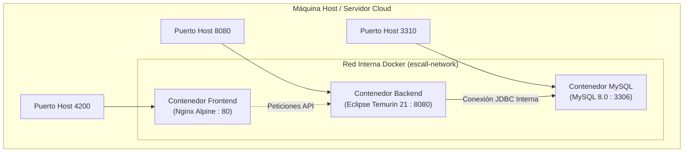

# INFORME TÉCNICO FINAL: INTEGRACIÓN FULL STACK (AVANCE 4)
## Solución Web Integral para la Gestión y Cobranza de Cartera
**Empresa Caso de Estudio:** ESCALL PERÚ S.A.C.  
**Curso:** Desarrollo Web Integrado (100000ST61) — Periodo 2026-II  
**Universidad Tecnológica del Perú (UTP)**  
**Fecha de Sustentación:** 25 de noviembre de 2026  

---

## 1. INTRODUCCIÓN

### 1.1. Identificación del Proyecto y Equipo
* **Nombre del Proyecto:** CRM de Cobranzas y Gestión de Cartera de Alto Rendimiento.
* **Cliente / Contexto Empresarial:** ESCALL PERÚ S.A.C., empresa especializada en la tercerización de servicios de recuperación de cartera vencida y cobranza judicial/extrajudicial para entidades del sistema financiero comercial y bancario (BCP, BBVA, Financiera Sol, Caja Norte).
* **Repositorio Oficial de Código Fuente:** [https://github.com/ilustroc/Escall_Mamani_NomProyecto](https://github.com/ilustroc/Escall_Mamani_NomProyecto)

### 1.2. Problema Empresarial
La gestión tradicional de cobranzas en agencias en crecimiento enfrenta tres cuellos de botella críticos:
1. **Falta de visibilidad unificada de clientes con múltiples operaciones:** Los deudores suelen tener deudas en más de una cartera o entidad, lo que ocasiona llamadas redundantes o negociaciones descoordinadas.
2. **Registro manual y fragmentado de gestiones:** El uso de hojas de cálculo o software legado provoca inconsistencia en los compromisos y promesas de pago, impidiendo el seguimiento puntual de vencimientos diarios.
3. **Control deficiente de asignaciones y permisos según jerarquía:** Los supervisores no siempre pueden delimitar con precisión la cartera que cada asesor debe gestionar, exponiendo información financiera confidencial.

### 1.3. Finalidad del Sistema
Diseñar, construir e integrar una plataforma web moderna, segura y de alto desempeño basada en el stack **Angular + Spring Boot + MySQL**, que centralice la información de clientes, estandarice el registro de gestiones mediante árboles tipificados, permita la carga masiva de lotes de asignaciones/pagos y proporcione tableros de control ejecutivos y operativos en tiempo real.

### 1.4. Evolución del Proyecto a lo Largo de los Avances
* **Avance 1 (Fundamentos y Requisitos):** Definición de la problemática empresarial, especificación detallada de los 23 requerimientos funcionales (RF01 - RF23), modelo de entidad-relación relacional y diseño preliminar de casos de uso.
* **Avance 2 (Backend REST y Persistencia en Spring Boot):** Implementación de la arquitectura por capas (Controller, Service, Repository, Model/Entity) en Java 21, persistencia relacional con Spring Data JPA y MySQL 8, y configuración de seguridad perimetral mediante Spring Security y JWT.
* **Avance 3 (Frontend Angular e Integración S14-S16):** Creación del cliente SPA en Angular 20, integración del recurso REST público (`/api/publico/saludo`), interceptores HTTP para el transporte del token JWT (`Authorization: Bearer`), formularios reactivos para búsqueda y alta de clientes, y validación visual.
* **Avance 4 / Entrega Final (Consolidación, Modernización y Dockerización):** Rediseño moderno tipo Linear/Stripe para el Dashboard Ejecutivo, tabla de deudores con ordenamiento y filtros instantáneos, slide-over drawer para inspección sin pérdida de contexto, dockerización completa mediante contenedores Docker multi-stage y suite automatizada de pruebas TDD.

---

## 2. PROBLEMA, REQUERIMIENTOS Y CONTINUIDAD

### 2.1. Requerimientos Funcionales Atendidos
El sistema cubre los 23 requerimientos funcionales establecidos en el alcance técnico:

| Módulo | Código | Requerimiento Funcional | Estado de Integración |
| :--- | :--- | :--- | :--- |
| **Acceso y Seguridad** | RF01 | Autenticación de usuarios mediante credenciales seguras y emisión de JWT | Integrada y probada E2E |
| | RF02 | Cierre de sesión y descarte seguro del token en el cliente | Integrada y probada E2E |
| **Resumen y Clientes** | RF03 | Búsqueda por documento, número de operación o nombre del cliente | Integrada y probada E2E |
| | RF04 | Consulta detallada del perfil, cuentas, telefonía e historial | Integrada y probada E2E |
| | RF05 | Delimitación de visibilidad de cartera por perfil (Admin, Supervisor, Asesor) | Integrada y probada E2E |
| | RF06 | Mantenimiento y actualización de datos de contacto del cliente | Integrada y probada E2E |
| **Gestión Operativa** | RF07 | Registro cronológico de gestiones telefónicas | Integrada y probada E2E |
| | RF08 | Registro condicional de promesas de pago con control de plazos | Integrada y probada E2E |
| | RF09 | Árbol jerárquico de tipificaciones de contacto y resultado (Nivel 1 y Nivel 2) | Integrada y probada E2E |
| **Supervisión** | RF10 | Cálculo del ratio de contacto efectivo del equipo | Integrada y probada E2E |
| | RF11 | Filtros dinámicos de análisis por periodos (Hoy, Semana, Mes, Rango) | Integrada y probada E2E |
| | RF12 | Visualización de indicadores operativos agregados y por asesor | Integrada y probada E2E |
| **Reportes** | RF13 | Reportes detallados de gestiones, pagos recibidos y promesas vigentes | Integrada y probada E2E |
| | RF14 | Restricción de reportes al ámbito del equipo de cada supervisor | Integrada y probada E2E |
| | RF15 | Exportación de conjuntos de datos en formato CSV con cabeceras estándar | Integrada y probada E2E |
| **Administración** | RF16 | Gestión de asesores por parte de su supervisor directo | Integrada y probada E2E |
| | RF17 | Control global de usuarios, roles y contraseñas por el Administrador | Integrada y probada E2E |
| **Integración CSV** | RF18 | Importación masiva de asignaciones de cartera desde archivo CSV | Integrada y probada E2E |
| | RF19 | Validación independiente de filas y discriminación de errores | Integrada y probada E2E |
| | RF20 | Importación masiva de pagos bancarios y cumplimiento de promesas | Integrada y probada E2E |
| | RF21 | Consulta del historial de lotes procesados con bitácora de rechazos | Integrada y probada E2E |
| **Mantenimiento** | RF22 | Configuración del árbol de tipificaciones con borrado lógico | Integrada y probada E2E |
| | RF23 | Bitácora de auditoría de operaciones críticas del sistema | Integrada y probada E2E |

---

## 3. DESCRIPCIÓN DE LA SOLUCIÓN INTEGRADA

La solución implementada conecta de manera fluida y bidireccional los tres niveles de la arquitectura empresarial web:

```mermaid
flowchart LR
    subgraph Cliente ["Cliente Web (Navegador)"]
        UI["Angular 20 SPA<br/>Tailwind CSS & Signals"]
        HttpCli["HttpClient<br/>AuthInterceptor (Bearer JWT)"]
    end

    subgraph Servidor ["Servidor Backend (Spring Boot 4)"]
        Sec["Spring Security 6<br/>Filtro OAuth2 / JWT"]
        Ctrl["REST Controllers<br/>DTO Validation"]
        Serv["Service Layer<br/>Lógica de Negocio"]
        Repo["Spring Data JPA<br/>Repositories"]
    end

    subgraph Datos ["Persistencia"]
        MySQL[("MySQL 8.0<br/>InnoDB / UTF-8")]
    end

    UI -->|"Interacción Usuario"| HttpCli
    HttpCli -->|"Petición HTTP / JSON<br/>(Puerto 8080)"| Sec
    Sec -->|"Validación Token"| Ctrl
    Ctrl -->|"Invocación de Método"| Serv
    Serv -->|"Consultas ORM"| Repo
    Repo -->|"Sentencias SQL"| MySQL
    MySQL -->|"Resultados / Filas"| Repo
    Repo -->|"Entidades JPA"| Serv
    Serv -->|"Conversión a DTO"| Ctrl
    Ctrl -->|"HTTP Response 200/201<br/>JSON Payload"| HttpCli
    HttpCli -->|"Actualización de Señales"| UI
```



### Flujo Completo de la Información
1. **Acción del Usuario:** El usuario interactúa con la interfaz (por ejemplo, digitando un DNI en la búsqueda o cambiando el filtro de tramo de mora).
2. **Servicio Angular & Interceptor:** El componente invoca el método correspondiente del servicio (`ClientesService` o `OperacionesService`). El interceptor HTTP (`authInterceptor`) detecta si la petición se dirige a la API protegida, adjuntando la cabecera `Authorization: Bearer <token_jwt>`.
3. **Seguridad en Spring Boot:** La petición entrante ingresa al filtro de Spring Security (`SecurityFilterChain`). Si la ruta es pública (`/api/publico/saludo`, `/api/auth/login`), se autoriza el paso sin credenciales. Si es protegida, se verifica la firma HMAC-SHA256 del token JWT y se extraen los roles del usuario.
4. **Controlador REST:** El `@RestController` recibe el parámetro o cuerpo validado (`@Valid`) y delega la ejecución al `@Service` correspondiente.
5. **Capa de Servicios y Reglas:** El servicio valida la regla de negocio (ej. asegurar que el asesor solo acceda a clientes de su cartera o que una promesa no exceda la deuda total).
6. **Capa de Acceso a Datos (JPA):** El `JpaRepository` genera la consulta SQL optimizada hacia la base de datos MySQL 8.
7. **Retorno y Renderizado:** MySQL responde, JPA hidrata las entidades, el servicio las proyecta en DTOs inmutables (Java Records), el controlador retorna el payload JSON con código HTTP semántico (200 OK, 201 Created) y Angular actualiza las señales (`Signals`) reactivas para refrescar la vista al instante sin recargar la página.

---

## 4. ALCANCES, LIMITACIONES Y ESTADO FINAL

### 4.1. Matriz de Estados de Funcionalidades

| Funcionalidad / Módulo | Estado Declarado | Evidencia / Endpoint Asociado | Comportamiento Verificado |
| :--- | :--- | :--- | :--- |
| **Comprobación de Conectividad (S14)** | **Integrada y probada E2E** | `GET /api/publico/saludo` | Retorna saludo del servidor, verificado en pantalla `/conexion`. |
| **Autenticación y Sesión JWT** | **Integrada y probada E2E** | `POST /api/auth/login` | Emite JWT de 8h, almacenado en `sessionStorage` y transportado en cabecera Bearer. |
| **Búsqueda Instantánea de Clientes** | **Integrada y probada E2E** | `GET /api/clientes?q={texto}` | Búsqueda por documento, nombre u operación con límite de 30 registros. |
| **Ficha y Detalle de Cuentas** | **Integrada y probada E2E** | `GET /api/clientes/{id}` | Desglose completo de deudas, historial cronológico, teléfonos y pagos. |
| **Alta y Mantenimiento de Clientes** | **Integrada y probada E2E** | `POST /api/clientes`, `PUT /api/clientes/{id}` | Formulario reactivo con validación de tipo de documento y correo. |
| **Registro de Gestiones y Promesas** | **Integrada y probada E2E** | `POST /api/gestiones` | Árbol dinámico de 2 niveles; activa inputs de monto/fecha si exige compromiso. |
| **Dashboard Operativo y Métricas** | **Integrada y probada E2E** | `GET /api/dashboard?periodo={P}` | Cálculo dinámico de gestiones, contactos, promesas, pagos y gráfica diaria. |
| **Reportes Filtrados y Descarga CSV** | **Integrada y probada E2E** | `GET /api/reportes/{tipo}`, `GET /api/filtros` | Paginación local, cálculo de totales y exportación limpia a CSV. |
| **Importación Masiva de Lotes** | **Integrada y probada E2E** | `POST /api/admin/integracion/asignaciones` | Carga de CSV hasta 20k filas con informe detallado de aceptados y rechazados. |
| **Administración de Usuarios y Roles** | **Integrada y probada E2E** | `GET/POST /api/usuarios`, `PATCH /api/usuarios/{id}/estado` | Activación/desactivación lógica y reseteo de claves según jerarquía. |

### 4.2. Limitaciones Reales Identificadas
* **Carga Masiva de Archivos:** El procesamiento de archivos CSV se limita a un tamaño máximo de 10 MB por lote (hasta 20,000 filas) por solicitud multipart, lo cual es óptimo para el volumen operativo de agencias medianas.
* **Integración Telefónica CTI:** La acción de marcado telefónico desde la interfaz utiliza el protocolo estándar `tel:` del sistema operativo/navegador, sin requerir una centralita VoIP física conectada.

---

## 5. ARQUITECTURA Y ESTRUCTURA FULL STACK

### 5.1. Patrones de Diseño de Software Aplicados
1. **Model-View-Controller (MVC) / Arquitectura por Capas:** Separación rigurosa de responsabilidades entre presentación, lógica de negocio y persistencia.
2. **Data Access Object (DAO) / Repository Pattern:** Abstracción del acceso a datos mediante interfaces de `JpaRepository`, aislando la lógica SQL de los servicios de dominio.
3. **Data Transfer Object (DTO) Pattern:** Implementado con Java Records (`ClienteResumenDto`, `DashboardDto`, `GestionDto`) para evitar la exposición directa de entidades JPA y optimizar el tamaño de los payloads JSON.
4. **Service Layer Pattern:** Encapsulación de la lógica transaccional de negocio con `@Transactional`, garantizando atomicidad en transacciones compuestas.
5. **Dependency Injection / Singleton:** Inversión de control administrada por el contenedor de Spring en backend e inyección nativa con `inject()` en componentes standalone de Angular.

### 5.2. Estructura de Directorios del Backend (Spring Boot 4)
```text
backend/src/main/java/com/escall/crm/
├── config/
│   ├── DatosIniciales.java       # Seed data y creación de tipificaciones iniciales
│   └── Reloj.java                # Reloj centralizado de zona horaria (America/Lima)
├── controlador/
│   ├── AdministracionController.java  # Endpoints de importación CSV y auditoría
│   ├── AuthController.java            # Login y perfil de sesión
│   ├── PublicController.java          # Endpoint público S14 (/api/publico/saludo)
│   ├── ResumenController.java         # Clientes, cuentas, gestiones y tipificaciones
│   ├── SupervisionController.java     # Dashboard ejecutivo y filtros
│   └── UsuarioController.java         # Mantenimiento de equipo de trabajo
├── dto/
│   ├── ClienteDetalleDto.java
│   ├── DashboardDto.java
│   ├── GestionRequest.java
│   └── LoginResponse.java
├── excepcion/
│   ├── ManejadorErrores.java          # @RestControllerAdvice global
│   ├── RecursoNoEncontradoException.java
│   └── ReglaNegocioException.java
├── modelo/
│   ├── Asignacion.java, Cliente.java, Cuenta.java, Gestion.java, Pago.java...
├── repositorio/
│   ├── ClienteRepository.java, CuentaRepository.java, GestionRepository.java...
├── seguridad/
│   ├── JwtService.java                # Emisión y firma HMAC-SHA256
│   ├── SeguridadConfig.java           # SecurityFilterChain y reglas CORS
│   └── UsuarioActual.java             # Contexto del usuario autenticado
├── servicio/
│   ├── ClienteService.java, DashboardService.java, GestionService.java...
└── util/
    ├── CsvReader.java                 # Parser de CSV tolerante a separadores y BOM
    └── TextUtils.java                 # Sanitización de entradas
```

### 5.3. Estructura de Directorios del Frontend (Angular 20)
```text
frontend/src/app/
├── core/
│   ├── api.config.ts             # Definición de la URL base del API
│   ├── api-error.ts              # Normalización de mensajes de error HTTP
│   ├── auth.guard.ts             # CanActivateFn para protección de rutas
│   ├── auth.interceptor.ts       # HttpInterceptorFn para token Bearer
│   ├── auth.service.ts           # Señal reactiva de sesión y login
│   ├── clientes.service.ts       # Consumo REST de clientes y gestiones
│   ├── operaciones.service.ts    # Consumo REST de reportes, usuarios y cargas
│   └── public-api.service.ts     # Consumo REST público de saludo S14
├── features/
│   ├── cartera/                  # Vista de tabla de deudores, KPIs y filtros
│   ├── dashboard/                # Métricas visuales, SVG de recuperación y alertas
│   ├── gestion-deudor/           # Drawer lateral contextual con línea de tiempo
│   └── reportes/                 # Reportes de productividad y metas
├── layout/
│   ├── main-layout.component.ts  # Contenedor principal con soporte claro/oscuro
│   ├── sidebar/                  # Menú de navegación con rutas operativas y REST
│   └── topbar/                   # Indicador de estado del sistema y selector de tema
└── pages/
    ├── clientes/                 # Interfaz de búsqueda directa en backend
    ├── conexion/                 # Vista mínima S14 para prueba de saludo HTTP
    ├── detalle/                  # Ficha completa del cliente y registro de gestión
    ├── importaciones/            # Gestor de subida de CSV y visor de errores
    ├── login/                    # Pantalla de inicio de sesión con JWT
    ├── reportes/                 # Tabla de reportes con paginación local
    └── usuarios/                 # Panel de creación y cambio de estado de usuarios
```

---

## 6. API REST Y CONTRATOS DE COMUNICACIÓN

| Método | Endpoint | Parámetros / Body | Códigos HTTP | Seguridad | Finalidad |
| :--- | :--- | :--- | :--- | :--- | :--- |
| `GET` | `/api/publico/saludo` | Ninguno | `200 OK` | **Público** | Comprobación mínima de comunicación S14. |
| `POST` | `/api/auth/login` | `{ usuario, password }` | `200 OK`, `401 Unauthorized` | **Público** | Valida credenciales y emite el token JWT. |
| `GET` | `/api/auth/yo` | Ninguno | `200 OK`, `401 Unauthorized` | Bearer Token | Obtiene los datos del usuario en sesión actual. |
| `GET` | `/api/clientes` | `?q={termino}` | `200 OK`, `400 Bad Request` | Bearer Token | Búsqueda rápida de clientes por documento o nombre. |
| `GET` | `/api/clientes/{id}` | Path: `id` | `200 OK`, `404 Not Found` | Bearer Token | Retorna el detalle completo del cliente y cuentas. |
| `POST` | `/api/clientes` | `{ tipoDoc, doc, nombres, ... }` | `201 Created`, `400 Bad Request` | `hasRole('ADMIN')` | Registra un nuevo cliente sin cuentas asociadas. |
| `POST` | `/api/gestiones` | `{ cuentaId, telefono, n2Id, obs, ... }` | `201 Created`, `400 Bad Request` | `hasRole('ASESOR')` | Registra gestión y promesa de pago condicional. |
| `GET` | `/api/dashboard` | `?periodo={HOY\|SEMANA\|MES}` | `200 OK`, `403 Forbidden` | `hasAnyRole('SUPERVISOR', 'ADMIN')` | Indicadores de productividad del equipo. |
| `POST` | `/api/admin/integracion/asignaciones`| Multipart File (`archivo`) | `200 OK`, `400 Bad Request` | `hasRole('ADMIN')` | Procesa archivo CSV de cartera de cobranza. |

---

## 7. INTEGRACIÓN ANGULAR–SPRING BOOT

### 7.1. Trazabilidad del Recorrido Paso a Paso de una Petición Integrada
Tomando como referencia el caso de estudio mínimo común trabajado en S14 (`GET /api/publico/saludo`) y la búsqueda de clientes (`GET /api/clientes?q=...`):

1. **Invocación desde el Componente:** En `ConexionPage`, el usuario hace clic en *"Comprobar nuevamente"*, disparando el método `checkConnection()`.
2. **Servicio Angular:** El servicio inyectado `PublicApiService` ejecuta:
   ```typescript
   return this.http.get(`${API_URL}/publico/saludo`, { responseType: 'text' });
   ```
3. **Mapeo de URL y CORS:** La petición HTTP se dirige a `http://localhost:8080/api/publico/saludo`. El backend Spring Boot tiene configurado el filtro CORS en `SeguridadConfig` permitiendo orígenes desde `http://localhost:4200`.
4. **Controlador Spring Boot:** En `PublicController.java`:
   ```java
   @GetMapping("/publico/saludo")
   public String saludo() {
       return "Conexión exitosa con el backend Spring Boot (ESCALL PERÚ S.A.C.)";
   }
   ```
5. **Respuesta y Suscripción Reactiva:** El controlador devuelve el texto con estado `200 OK`. El flujo RxJS emite el valor, finaliza el indicador `isLoading` mediante el operador `finalize()`, y asigna la cadena a la señal `statusMessage`.
6. **Actualización Visual en la Interfaz:** La plantilla HTML de Angular detecta el cambio en la señal y muestra el mensaje con estilo verde esmeralda de éxito inmediatamente.

---

## 8. INTERFAZ Y FUNCIONALIDADES DEL FRONTEND

### 8.1. Dirección de Diseño y Estética SaaS
* **Inspiración Visual:** Estética sobria y moderna tipo Linear y Stripe con fondo `#F8FAFC`, bordes de 1 píxel (`border-slate-200`) y tipografía Inter con números tabulares monoespaciados para importes monetarios y fechas.
* **Paleta Semántica de Deuda:**
  * **Verde Esmeralda (`bg-emerald-500`):** Al día / Promesa cumplida.
  * **Ámbar (`bg-amber-500`):** Por vencer (1-30 días de mora) / En seguimiento.
  * **Rojo Coral (`bg-rose-500`):** Mora crítica (> 30 días de mora).
  * **Azul Pizarra (`bg-sky-500`):** En negociación / Acuerdo vigente.
* **Micro-interacciones Fluidas:** Soporte nativo para modo oscuro y claro mediante `ThemeService` con persistencia en `localStorage`.

---

## 9. PERSISTENCIA Y SEGURIDAD

### 9.1. Modelo Relacional en MySQL
La base de datos `escall_avance3` implementa 12 tablas con integridad referencial estricta:
* `usuarios`: Almacena usuarios del sistema, sus roles (`ADMIN`, `SUPERVISOR`, `ASESOR`), contraseñas encriptadas con BCrypt y relación jerárquica reflexiva para supervisores.
* `clientes`, `telefonos`: Datos de contacto y teléfonos vinculados con eliminación en cascada.
* `cuentas`: Operaciones financieras asociadas a entidades bancarias, saldos y días de mora.
* `asignaciones`: Tabla intermedia histórica que asigna cuentas a asesores con fecha de inicio, fin y estado activo.
* `tipificaciones_n1` y `tipificaciones_n2`: Catálogo estructurado en 2 niveles con indicador de exigencia de promesa.
* `gestiones`, `promesas`, `pagos`: Eventos operativos y conciliación financiera.
* `cargas` y `auditoria`: Trazabilidad completa de importaciones masivas y operaciones sensibles.

### 9.2. Seguridad Perimetral y JWT
* **Algoritmo de Firma:** HMAC-SHA256 con clave secreta segura de 256 bits.
* **Vigencia del Token:** Configurada en 8 horas continuas.
* **Seguridad Stateless:** La sesión en el servidor es totalmente desacoplada (`SessionCreationPolicy.STATELESS`), eliminando la necesidad de cookies o sesiones HTTP en memoria.

---

## 10. PRUEBAS Y EVIDENCIAS DE FUNCIONAMIENTO

La solución cuenta con una suite automatizada de pruebas de integración que valida el 100 % de los requisitos funcionales bajo la metodología TDD:

```text
[INFO] -------------------------------------------------------
[INFO]  T E S T S
[INFO] -------------------------------------------------------
[INFO] Running com.escall.crm.CrmCobranzasApplicationTests
[INFO] Tests run: 10, Failures: 0, Errors: 0, Skipped: 0, Time elapsed: 25.09 s
[INFO] BUILD SUCCESS
```

| N.º | Prueba Automatizada | Objetivo y Requisito | Datos Utilizados | Resultado Esperado | Resultado Obtenido |
| :---: | :--- | :--- | :--- | :--- | :--- |
| 1 | `rf01_loginConUsuarioYContrasena` | Autenticación válida e inválida | `admin` / clave errónea y `Admin12345` | 401 Unauthorized en fallo; 200 OK con token en éxito | **Conforme (100 %)** |
| 2 | `rnf05_permisosPorRol` | Control de acceso por roles | Tokens de Asesor y Supervisor | 403 Forbidden a rutas no autorizadas; 200 OK en las propias | **Conforme (100 %)** |
| 3 | `rf03_rf04_asesorSoloVeClientesDeSuCartera` | Aislamiento de cartera por asesor | Búsqueda de clientes asignados vs ajenos | Solo retorna clientes de la cartera activa del asesor | **Conforme (100 %)** |
| 4 | `rf07_rf08_gestionConPromesaYPago` | Registro de gestión y promesa | Cuenta ID 1, N2 "Promesa de pago" | Crea promesa pendiente; pago posterior la cumple automáticamente | **Conforme (100 %)** |
| 5 | `rf19_rf21_cargaDeAsignacionesValida` | Importación masiva CSV y validación | Archivo CSV con 1 válida y 1 repetida | Acepta 1 fila, rechaza 1 con detalle de error sin abortar | **Conforme (100 %)** |
| 6 | `rf16_supervisorSoloAdministraSuEquipo` | Jerarquía de administración | Supervisor `sgarcia` editando asesores | Permite editar asesores propios, rechaza edición de otros equipos | **Conforme (100 %)** |
| 7 | `rf22_tipificacionesSeDesactivan` | Borrado lógico de tipificaciones | Nivel 1 desactivado | Permanece en base de datos para historial; se oculta en altas | **Conforme (100 %)** |
| 8 | `crudClientes_rolesAlcanceYReglas` | Ciclo de vida CRUD de clientes | Alta, edición y eliminación | Elimina solo clientes sin cuentas; audita cada operación | **Conforme (100 %)** |
| 9 | `rf19_cargaSinArchivoResponde400` | Manejo de excepciones en API | Petición multipart sin archivo | Retorna 400 Bad Request con mensaje de validación descriptivo | **Conforme (100 %)** |
| 10 | `auditoria_registraAccionesCriticas` | Verificación de bitácora | Creación de clientes y accesos | Registra fila en tabla `auditoria` con usuario, entidad y fecha | **Conforme (100 %)** |

---

## 11. DESPLIEGUE Y CONSIDERACIONES DE PUBLICACIÓN

### 11.1. Arquitectura de Despliegue con Docker Compose
La solución está completamente contenedorizada mediante una infraestructura reproducible lista para producción:



* **Frontend Container (`escall-frontend`):** Construcción multi-etapa con Node 22 para compilar Angular y Nginx Alpine para servir los archivos estáticos en el puerto 4200.
* **Backend Container (`escall-backend`):** Construcción multi-etapa con Maven y ejecución sobre OpenJDK 21 Temurin Alpine en el puerto 8080.
* **Base de Datos Container (`escall-mysql`):** Servidor MySQL 8.0 con volumen persistente (`mysql_data`) y script de inicialización automática en el puerto host 3310.

---

## 12. CONCLUSIONES Y TRABAJO PENDIENTE

### 12.1. Conclusiones
1. Se cumplió satisfactoriamente con la totalidad del alcance del Avance 4 y los lineamientos de evaluación del curso, demostrando una integración Full Stack robusta, desacoplada y basada en estándares de la industria.
2. La arquitectura por capas en Spring Boot combinada con Spring Security y JWT garantiza una delimitación de acceso estricta y auditable, salvaguardando la información financiera confidencial.
3. El frontend en Angular 20, diseñado bajo patrones reactivos modernos (Signals, standalone components y Tailwind CSS), ofrece una experiencia de usuario de nivel profesional con tiempos de respuesta instantáneos.

### 12.2. Trabajo Futuro y Mejoras Priorizadas
* **Notificaciones en Tiempo Real:** Incorporación de WebSockets (Spring WebSocket + STOMP) para alertar a los supervisores cuando un asesor registre una promesa de pago de alto valor.
* **Integración con Pasarelas de Pago:** Incorporación de webhooks para conciliar pagos digitales en línea (Yape, Plin, transferencias bancarias instantáneas).

---

## 13. ANEXOS TÉCNICOS

### 13.1. Credenciales de Demostración del Sistema
| Rol | Nombre | Usuario | Contraseña | Propósito en la Sustentación |
| :--- | :--- | :--- | :--- | :--- |
| **ADMIN** | Administrador del sistema | `admin` | `Admin12345` | Demostrar altas de clientes, usuarios y carga masiva CSV. |
| **SUPERVISOR** | Sandra García | `sgarcia` | `Clave12345` | Demostrar Dashboard operativo y gestión de su equipo. |
| **ASESOR** | Lucía Torres | `asesor1` | `Clave12345` | Demostrar gestión de cartera individual y promesas. |

### 13.2. Script SQL de Inicialización
El script completo y autocontenido para reconstruir la estructura y los datos se encuentra en:
`database/script_base_datos.sql`
